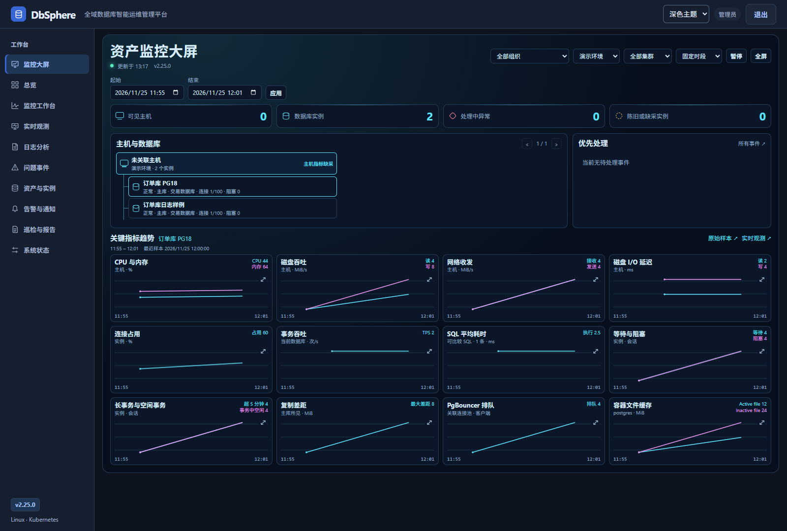
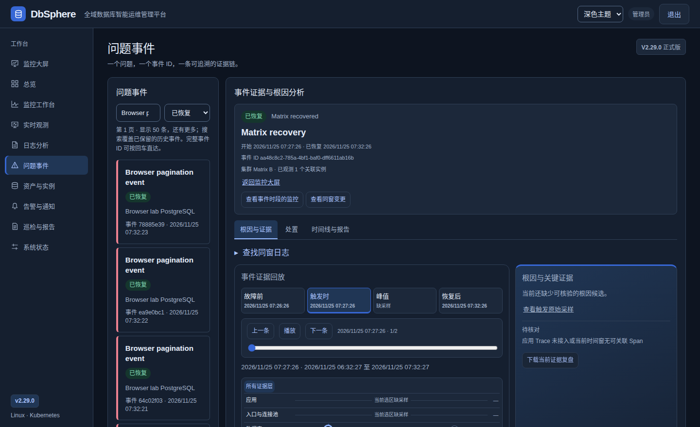

# DbSphere

**全域数据库智能运维管理平台**

 

DbSphere 是面向 PostgreSQL 的开源运维工作台。在浏览器中查看数据库、Linux 和 Kubernetes 指标，从一张异常图表进入问题事件，沿同一个事件 ID 查到根因候选、原始证据和恢复记录。

**[快速开始](docs/QUICK_START.md)** · [下载一键离线包](https://github.com/cuipengdba/DbSphere/releases/latest) · [部署手册](docs/OFFLINE_DEPLOYMENT.md) · [支持矩阵](docs/SUPPORT_MATRIX.md)

## 界面预览

以下为隔离验收环境中的实际界面，使用演示数据。

### 资产监控大屏

按组织、环境或集群查看实例、主机、优先事件和 12 张关键趋势图。点击图片可看原尺寸。

| 放大趋势 | 同一事件查看日志 |
| --- | --- |
| 放大后保留当前实例、时间窗和同步游标。 | 已采纳的慢 SQL 与原始记录保留在当前事件中。 |
|  |  |

### 同一事件的根因与证据

按故障阶段核对数据库、应用和基础设施信号。可从证据时间线打开原始采样或日志，再回到同一个事件记录处置结果。

| 事件证据回放 | 容器文件缓存对照 |
| --- | --- |
| 拖动游标核对阶段证据、根因关联和恢复记录。 | 不同容器使用相同刻度和游标，可打开对应时间桶的原始采样。 |
|  |  |

## 功能说明

| 领域 | 功能 |
| --- | --- |
| 资产纳管 | 支持 PostgreSQL 14–19、瀚高安全版 4.5.9，以及 MySQL 8.4 只读预览。支持 Linux、Docker、Kubernetes 和托管数据库，提供批量清单预览与导入、授权资产导出、连接及权限体检。 |
| 监控工作台 | 从集群下钻到实例、数据库和 SQL。对照连接、事务、等待、锁、WAL、复制、检查点和容量，支持同窗多实例对比、短时等待采样、历史阻塞树回放和原始样本。 |
| 监控大屏 | 按资产查看 12 张可放大趋势图。可保存和分享值班视图，叠加前一窗口、昨日、上周及变更前后的基线。支持同步游标、固定时段和基线采样下钻。 |
| 基础设施 | 监控 Linux 主机资源、Docker 容器和 Kubernetes Pod、Node、PVC 与事件。磁盘 I/O、IOPS、压力和文件缓存为独立专题，支持并排比较容器的 `active_file` 和 `inactive_file`。 |
| SQL 与对象 | 分析 Top SQL 指纹、锁链、慢日志和执行计划，核对对象大小、死元组、冻结、Vacuum、Analyze、分区与索引状态。 |
| 主备与服务入口 | 查看 Patroni、CloudNativePG、PgBouncer、HAProxy 与 Kubernetes Service 的可用信号，分析逻辑复制槽、回放延迟、积压和切换。核对入口探测与实际后端。 |
| 事件与根因 | 以同一个事件 ID 关联应用 Trace、PG 会话、连接池、主机、K8S 和原始日志。可播放和拖动分层时间轴，对照事前、触发、峰值与恢复证据。原始采样支持站内阅读、JSON 下载和返回原调查。 |
| 日志分析 | 导入 PostgreSQL、瀚高、金仓 V9 和达梦 DM8 日志。支持项目和批次、断点续传、应用负载矩阵、延迟分布、原文回链、跨批次对比、调优复测、Zstd 归档及保留策略。 |
| 告警、巡检与变更 | 提供规则阈值、维护静默、Webhook 和邮件投递、风险回测、手动及定时巡检、变更时间线和 Markdown／HTML 报告。 |
| 权限与作业 | 按组织、项目团队和资产划分访问权限，支持本地账号、OIDC、凭据轮换和签名审计。受控采样、巡检或已配置作业支持预演、独立审批和结果回写。 |
| 增强可观测性 | 增强包内置 Prometheus 与 Grafana OSS，提供环境、PostgreSQL 集群、等待、SQL、复制、Linux、Kubernetes 和 MySQL 专题。平台管理员在 DbSphere 内打开面板，沿用当前资产和时段。 |
| 可选 AI | 可接入本地或 HTTPS 模型，基于同一事件的脱敏证据问答。采集、告警、巡检和规则根因分析可独立运行。 |
| 存储与交付 | Go 后端内嵌静态前端，独立 PostgreSQL 18 保存长期指标、证据和采集队列。支持指标分层留存、监控库备份、平台副本及共享采集租约。提供 Linux amd64／arm64 标准和增强一键离线包、静态程序和 systemd 安装包。 |

有数据源和权限时才显示对应信号。缺采和证据不足会显示在页面中，便于继续核对。[查看数据库与部署支持范围](docs/SUPPORT_MATRIX.md)

## 使用手册

- [从安装到首次采集](docs/QUICK_START.md) · [离线部署与升级](docs/OFFLINE_DEPLOYMENT.md)
- [监控工作台](docs/MONITORING_WORKSPACE.md) · [事件调查](docs/INCIDENT_INVESTIGATION.md) · [日志分析](docs/LOG_ANALYSIS.md)
- [Linux 与容器存储](docs/CONTAINER_STORAGE.md) · [Kubernetes 接入](docs/OFFLINE_DEPLOYMENT.md#kubernetes-接入) · [托管 PostgreSQL](docs/MANAGED_POSTGRESQL.md)
- [长期指标留存](docs/HISTORY_STORAGE.md) · [运维系统接口](docs/OPERATIONS_INTEGRATION.md) · [事件证据助手](docs/AI_EVIDENCE_REVIEW.md)

DbSphere 是独立开发的开源项目，采用 [Apache License 2.0](LICENSE)。欢迎提交 [问题反馈](https://github.com/cuipengdba/DbSphere/issues)。
