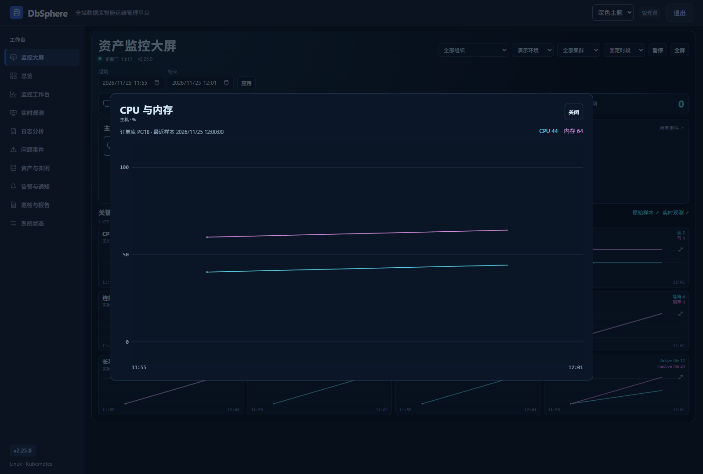
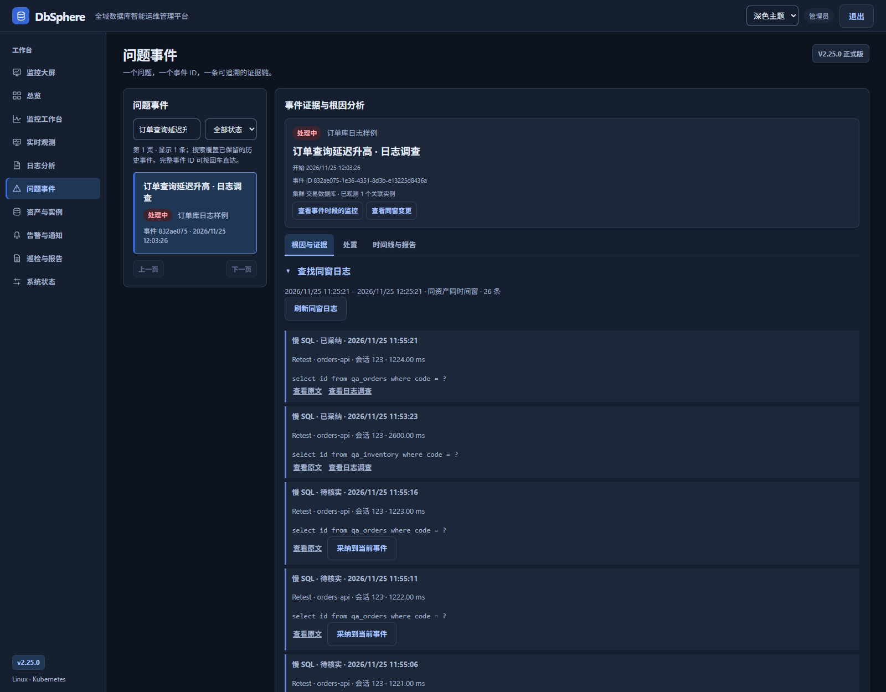
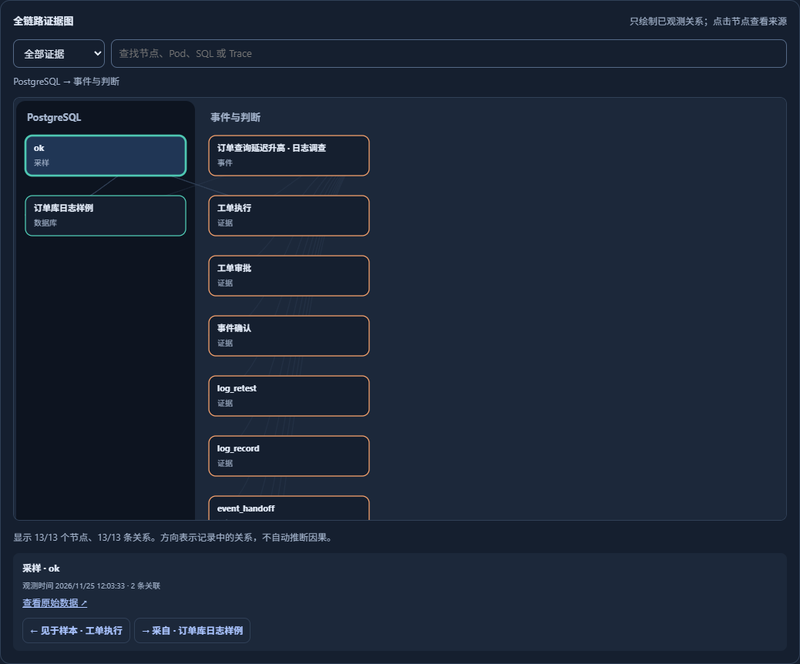
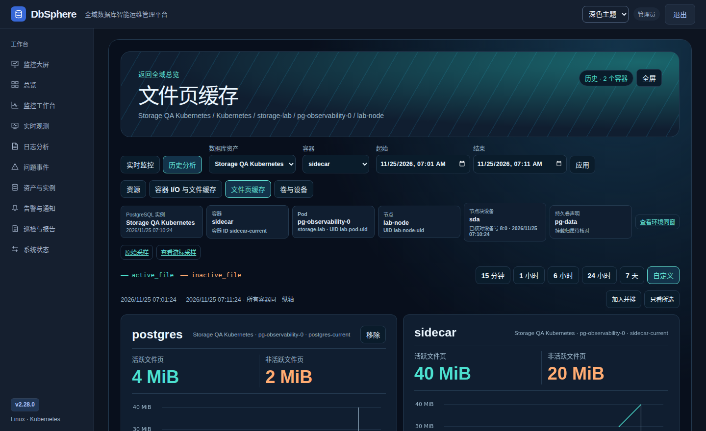

# DbSphere

**全域数据库智能运维管理平台**

 

DbSphere 是面向数据库、缓存和 Kubernetes 控制面的开源运维工作台。在浏览器中查看各引擎和 Linux 指标，从异常图表进入问题事件，沿同一个事件 ID 查到根因候选、原始证据和恢复记录。

**[快速开始](docs/QUICK_START.md)** · [下载 v3.19.0 一键离线包](https://github.com/cuipengdba/DbSphere/releases/tag/v3.19.0) · [部署手册](docs/OFFLINE_DEPLOYMENT.md) · [支持矩阵](#支持矩阵)

## 支持矩阵

| 纳管数据源 | 兼容版本或模式 | 主要采集与诊断能力 |
| --- | --- | --- |
| PostgreSQL | 14–19 | 连接、事务、锁与等待、WAL、复制、容量及 SQL 统计。 |
| PostgreSQL 日志持续接入 | v3.15.0 新增 | 按文件代次和确认偏移接收日志。PG18.7 实测 JSON Lines 增量接入、续传和事件内 SQL 复测。 |
| MySQL | 8.4 LTS | InnoDB 缓冲池、事务等待、SQL 指纹及复制通道。 |
| MySQL 日志持续接入 | 8.4 LTS · v3.15.0 新增 | MySQL 8.4.13 实测 FILE 慢日志增量接入、轮转和原事件回链。 |
| MySQL 写入口只读探测 | 8.4 LTS · v3.16.0 新增 | MySQL 8.4.13 双节点实测入口后端 UUID、只读副本误路由、复制追平与原事件恢复。 |
| 瀚高数据库 | 安全版 4.5.9，兼容内核 12.7 | 产品识别、会话等待及 SQL 指纹。 |
| 达梦数据库 | DM8 | 会话与事务锁、归档及 Data Watch 主备状态。 |
| 金仓 KingbaseES | V9，PostgreSQL 兼容模式 | 会话等待、SQL 指纹、归档及流复制状态。 |
| Redis OSS | 6.2 · v3.11.0 新增 | OPS、内存、命中与淘汰、慢命令及 Cluster 槽位。Redis 6.2.24 已验收单节点和三主节点 Cluster。 |
| Redis OSS | 7.2、8.4 | 单节点、主从、Sentinel 和 Cluster 指标，按 ACL 权限读取。 |
| etcd | 3.5、3.6 | 成员、Raft、WAL 与后端提交指标，可与 API Server 指标同窗对照。 |
| Linux 与 Docker | Linux 主机、Docker 容器 | 主机 CPU、内存、磁盘与网络，以及容器 I/O 和文件缓存。 |
| Kubernetes | 只读 API 与指标源 | Pod、Node、PVC、事件及容器资源观测，已验收的环境见详细矩阵。 |

各项能力取决于数据源版本、部署拓扑和采集权限。长期监控数据保存在独立 PostgreSQL 18。新增数据源、兼容版本或接入模式随正式版单独列项，记录首次支持版本和实测范围。权限要求和接入方式见[详细支持与验收矩阵](docs/SUPPORT_MATRIX.md)。

## 界面预览

以下为隔离验收环境中的实际界面，使用演示数据。

### 资产监控大屏

按组织、环境或集群查看各引擎的采集覆盖、实例健康和优先事件。切换资产后可放大对应引擎的趋势图。点击图片可看原尺寸。

| 放大趋势 | 同一事件查看日志 |
| --- | --- |
| 放大后保留当前实例、时间窗和同步游标。 | 已采纳的慢 SQL 与原始记录保留在当前事件中。 |
|  |  |

### 同一事件的根因与证据

按故障阶段核对数据库、应用和基础设施信号。可从证据时间线打开原始采样或日志，再回到同一个事件记录处置结果。

| 事件证据回放 | 容器文件缓存对照 |
| --- | --- |
| 拖动游标核对阶段证据、根因关联和恢复记录。 | 不同容器使用相同刻度和游标，可打开对应时间桶的原始采样。 |
|  |  |

## 功能说明

| 领域 | 功能 |
| --- | --- |
| 资产纳管 | 按支持矩阵接入数据源。批量接入后可以保存首采结果、查看原始证据并复检原资产。 |
| 监控工作台 | 从集群下钻到实例、数据库和 SQL。对照连接、事务、等待、锁、WAL、复制、检查点和容量，支持同窗多实例对比、短时等待采样、历史阻塞树回放和原始样本。 |
| 引擎专项诊断 | 在 MySQL、Redis 和 etcd 的时间窗中选择采样，对照引擎指标、权限缺口、原事件及恢复证据。 |
| 监控大屏 | 按引擎查看资产数、影响范围、近期采样、缺采、失败和端点失联。趋势图随资产引擎切换，支持放大、同步游标、固定时段、历史基线和原始采样。个人和团队值班视图可跨浏览器恢复。 |
| 基础设施 | 监控 Linux 主机、Docker 容器和 Kubernetes Pod、Node、PVC 与事件。可从事件核对同窗身份、设备映射、采集覆盖和重启记录，并排比较容器 I/O 与 `active_file`、`inactive_file`。 |
| SQL 与对象 | 分析 Top SQL 指纹、锁链、慢日志和执行计划，核对对象大小、死元组、冻结、Vacuum、Analyze、分区与索引状态。 |
| 主备与服务入口 | 按时间对照数据库直连角色、入口实际落点、控制面状态与复制进度。查看 PostgreSQL、MySQL、达梦 Data Watch 和金仓流复制的采样与同一事件证据。 |
| 事件与根因 | 以同一个事件 ID 查看应用对 Redis 和数据库的调用、PG 等待会话、Kubernetes API Server 与 etcd 同窗指标，以及 Linux、容器、PVC 和原始日志证据。按服务、引擎与实例筛选，可分派、确认接班、验证恢复并导出复盘。 |
| 日志分析 | 导入 PostgreSQL、瀚高、金仓 V9、达梦 DM8 和 MySQL 慢日志。支持项目和批次、断点续传、应用负载矩阵、延迟分布、原文回链、跨批次对比、调优复测、Zstd 归档及保留策略。 |
| 告警、巡检与变更 | 提供规则阈值、维护静默、Webhook 和邮件投递。支持 PostgreSQL、达梦、金仓、Redis 和 etcd 的业务时段风险基线、影子预警和历史回测，以及巡检、变更时间线和 Markdown／HTML 报告。 |
| 权限与作业 | 按组织、项目团队和资产划分访问权限，支持本地账号、OIDC、凭据轮换和签名审计。受控采样、巡检或已配置作业支持预演、独立审批和结果回写。 |
| 增强可观测性 | 增强包内置 Prometheus 与 Grafana OSS，提供环境、PostgreSQL 集群、等待、SQL、复制、Linux、Kubernetes 及各引擎专题。平台管理员在 DbSphere 内打开面板，沿用当前资产和时段。 |
| 采集健康 | 按引擎查看覆盖、权限缺口、退避、隔离、排队时延、目标查询与 PG18 写入耗时。两个或更多采集副本可通过 PostgreSQL 18 共用调度与租约。 |
| 可选 AI | 在系统状态中配置和测试模型、设置预算及超时。提交前可预览同事件证据和填写追问。模型停用时仍可使用采集、告警、巡检和规则根因分析。 |
| 存储与交付 | Go 后端内嵌静态前端，独立 PostgreSQL 18 保存长期指标、证据和采集队列。支持指标分层留存、监控库备份、平台副本及共享采集租约。提供 Linux amd64／arm64 标准和增强一键离线包、静态程序和 systemd 安装包。 |

有数据源和权限时才显示对应信号。缺采和证据不足会显示在页面中，便于继续核对。[查看数据库与部署支持范围](docs/SUPPORT_MATRIX.md)

## 使用手册

- [从安装到首次采集](docs/QUICK_START.md) · [离线部署与升级](docs/OFFLINE_DEPLOYMENT.md)
- [监控工作台](docs/MONITORING_WORKSPACE.md) · [事件调查](docs/INCIDENT_INVESTIGATION.md) · [日志分析](docs/LOG_ANALYSIS.md)
- [Linux 与容器存储](docs/CONTAINER_STORAGE.md) · [Kubernetes 接入](docs/OFFLINE_DEPLOYMENT.md#kubernetes-接入) · [托管 PostgreSQL](docs/MANAGED_POSTGRESQL.md) · [达梦 DM8](docs/DM8.md) · [金仓 V9](docs/KINGBASE.md) · [Redis](docs/REDIS.md) · [etcd 控制面](docs/ETCD.md)
- [长期指标留存](docs/HISTORY_STORAGE.md) · [运维系统接口](docs/OPERATIONS_INTEGRATION.md) · [事件证据助手](docs/AI_EVIDENCE_REVIEW.md)

DbSphere 是独立开发的开源项目，采用 [Apache License 2.0](LICENSE)。欢迎提交 [问题反馈](https://github.com/cuipengdba/DbSphere/issues)。
