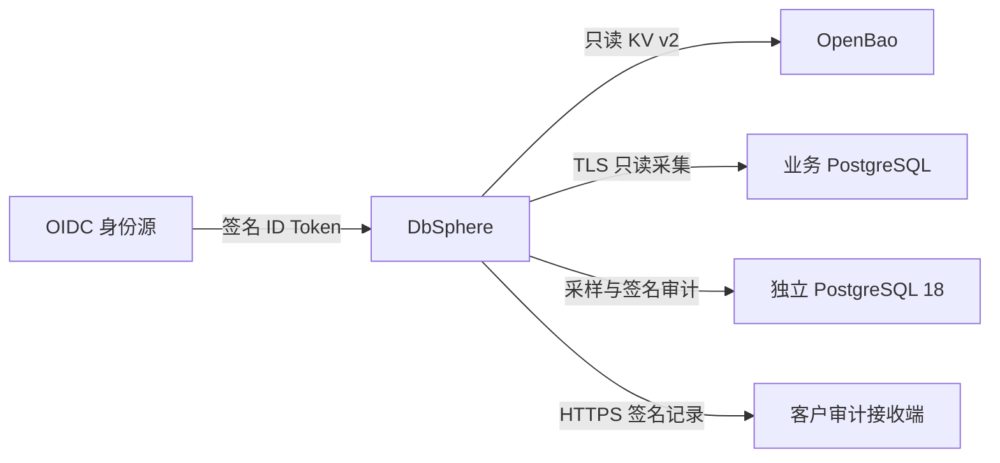

# 企业身份、OpenBao 与审计交付

## OIDC 组映射

按[离线部署手册](OFFLINE_DEPLOYMENT.md)配置 OIDC。平台管理员先创建组织和团队，再把身份源的 `sub` 绑定到组织内的 DbSphere 账号。身份源须在签名 ID Token 中返回 `groups` 字符串数组。若身份源需要额外 scope，设置 `DBSPHERE_OIDC_GROUP_SCOPE`。

`DBSPHERE_OIDC_GROUP_MAPPINGS` 填写 JSON 数组。以下示例将身份组 `dba-ops` 绑定到默认组织的运维角色和一个已有团队。

```json
[{"group":"dba-ops","organizationId":"00000000-0000-4000-8000-000000000001","role":"operator","teamIds":["00000000-0000-4000-8000-000000000002"]}]
```

组名区分大小写。命中多个组时，组织、角色和团队范围须完全一致。映射只授予组织内权限。启用组映射后，已绑定身份的账号须通过 OIDC 登录。新登录确认组或权限变化后会撤销该账号的旧会话。身份源不可用时，既有映射会话最多持续 15 分钟，且在 ID Token 到期时提前失效。可在 DbSphere 停用账号立即撤销其会话。更新映射配置时同步重启所有副本。

## 应急管理员

设置 `DBSPHERE_EMERGENCY_ADMIN=true` 后，内置 `admin` 只在本机应急窗口内接受已有密码。部署负责人在运行 DbSphere 的安全环境内执行 `dbsphere emergency-admin enable 15`，然后使用部署主机本机地址登录。核对操作记录后运行 `dbsphere emergency-admin review`，关闭窗口并立即使应急会话失效。站在客户端访问反向代理时，受控的本机入口仍须可达。启用、成功登录和复核都会进入签名审计。

## OpenBao KV v2

`DBSPHERE_OPENBAO_URL` 指向固定 HTTPS 地址，`DBSPHERE_OPENBAO_BINDINGS` 将每个 DbSphere 资产 UUID 映射到专用密钥路径和目标数据库身份。首批适用启用证书校验的直连 PostgreSQL 采集资产。`path` 格式为 `挂载名/密钥路径`，密钥字段名为 `password`。

```json
{"00000000-0000-4000-8000-000000000003":{"path":"secret/dbsphere/pilot","host":"pg.example.internal","port":5432,"database":"appdb","username":"dbsphere_monitor"}}
```

令牌只授予对应路径的读取权限。原生部署将 `DBSPHERE_OPENBAO_TOKEN_FILE` 设置为绝对文件路径。容器部署将 `DBSPHERE_OPENBAO_TOKEN_DIR` 指向绝对目录，目录下的 `token` 文件须可由容器采集用户读取。内网 CA 通过 `DBSPHERE_OPENBAO_CA_PEM_BASE64` 配置。先协调更新数据库密码和 KV v2 凭据，再复检原资产。原始样本记录 provider、KV 版本和连接验证状态。OpenBao 不可用时采集报告标出凭据缺口，其他未绑定资产继续采集。

## 权限与签名审计交付

| 操作 | 权限 |
| --- | --- |
| 查看规则诊断与脱敏样本 | 资产授权范围内的已有角色能力 |
| 打开单条 SQL 证据或归档日志原文 | 管理员，受组织及资产范围约束 |
| 导出组织签名审计 | 本组织管理员或平台管理员 |
| 配置审计投递和 OpenBao 服务 | 部署管理员 |

设置 `DBSPHERE_AUDIT_EXPORT_URL` 和 `DBSPHERE_AUDIT_EXPORT_ORGANIZATION` 启用一个指定组织的 HTTPS 投递。内网接收端证书可通过 `DBSPHERE_AUDIT_EXPORT_CA_PEM_BASE64` 建立信任。DbSphere 保存按组织和接收地址独立维护的游标，失败后自动重试。接收端核对预先保存的公钥指纹、记录签名、序列和前一条摘要。请求的 `Idempotency-Key` 是当前记录摘要。接收端将结果持久化后再返回 HTTP 2xx，收到重复的记录时保持幂等。组织审计条目只含操作元数据。


