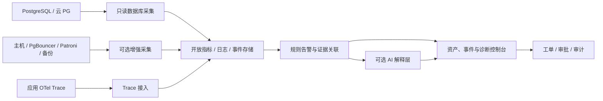

# DbSphere 产品设计草案

> 状态：规划稿，2026-11-15。以下是拟议产品能力和验收口径，尚未实现。

## 1. 定位、用户与边界

**定位**：以 PostgreSQL 为切入点，把数据库、主机、连接池、HA、备份与应用调用的观测证据关联到同一故障时间线，帮助 DBA 和 SRE 从“收到异常”走到“找到原因、确认影响、跟踪处置”。

**主要用户**：值班 DBA、SRE/平台工程师、应用研发、运维负责人。典型场景是慢 SQL、锁阻塞、连接耗尽、复制延迟、磁盘/WAL 压力、备份失败和应用响应变慢。

**V1.0 范围**：PostgreSQL 15–18 的自建实例与集群，以及提供足够监控权限的兼容云服务。PostgreSQL 14 已于 2026-11-12 到达上游支持终点，暂不列入正式支持矩阵；具体云厂商兼容性逐项验证。数据库内核、自动部署数据库集群、多数据库引擎、SQL 审核发布平台和无审批的自动修复不纳入 V1.0 承诺。V1.0 的“做全”是 PostgreSQL 运维监控、定位、诊断闭环，不是覆盖所有数据库管理操作。

## 2. 参考产品启发与 DbSphere 取舍

| 参考 | 可借鉴的能力方向 | DbSphere 的独立取舍 |
| --- | --- | --- |
| DeepLens | 资源纳管、模板化巡检、定时任务、异常报告、工单、可选 AI 解读 | 以连续监控为底座，巡检是周期性补充；从 V0.1 起无模型可用 |
| DBdoctor | SQL 性能洞察、锁与慢 SQL 可视化、根因诊断、问题闭环 | 先基于 PostgreSQL 官方视图、日志及可解释规则形成证据链；高级内核采集作为后续可选能力 |
| Pigsty | PostgreSQL/主机/连接池/HA/备份的丰富指标与现有集群纳管 | 以纳管已有环境为优先，采用开放指标和可插拔采集；不要求使用 Pigsty 部署数据库 |

产品信息与来源见 [RESEARCH.md](RESEARCH.md)。参考的是问题域与交互目标，不复制任何产品代码、文档、默认配置、仪表盘或视觉设计。

## 3. 关键使用流程

1. **纳管**：登记组织/环境/业务/集群/实例/数据库，验证连接与权限；选择无代理数据库采集或增强采集；显示可用信号、缺失信号和采集开销。
2. **发现**：健康总览按业务和集群展示 SLI、风险、告警及异常；从告警直接进入有起止时间的事件。
3. **定位**：事件页联动拓扑与时间线，按“应用服务 → 连接池/代理 → PostgreSQL 实例 → 会话/等待/锁 → SQL 指纹/执行计划 → 主机/存储/复制/备份”逐层下钻。缺少应用 Trace 时从连接池/数据库层开始，明确显示链路缺口。
4. **诊断**：规则引擎生成根因候选和影响面，列出证据、反证、时间先后与置信级别；运维人员确认、驳回或补充结论。
5. **处置与复盘**：关联负责人、工单、变更与处置记录；高风险操作走审批；导出脱敏事件报告，并核对恢复指标。

## 4. 功能域及 V1.0 目标

### 4.1 纳管与拓扑

- 纳管已有 PostgreSQL 实例、主从关系、数据库、业务服务和责任人；支持标签、环境、分组、凭据轮换与批量导入。
- 连接串模式只读取数据库可见信息；增强模式接入主机指标、PostgreSQL 日志、PgBouncer、Patroni、pgBackRest 等，按实际部署选择适配器。
- 每个资产展示采集能力矩阵和数据新鲜度，避免把“未采集”误报为“正常”。

### 4.2 PostgreSQL 监控目录

- **可用性与负载**：实例存活、角色/时间线、TPS、吞吐、连接数、活动会话、错误、事务回滚、检查点。
- **等待与锁**：等待事件分布、锁阻塞链、死锁、长事务、idle in transaction、年龄与冻结风险。
- **SQL**：慢 SQL 趋势、指纹、调用量、总耗时、平均/分位耗时（有样本时）、读写与临时文件、执行计划快照及变化。
- **存储与维护**：数据库/表/索引容量和增长、表膨胀估计、顺序扫描、缓存命中、autovacuum、WAL 产量与归档。
- **高可用与恢复**：复制延迟、复制槽、Patroni 状态（如存在）、备份结果、备份年龄、恢复演练记录（如接入）。
- **基础设施**：CPU、内存、磁盘容量/IO、文件系统、网络、PgBouncer/代理指标（需相应采集）。

指标按适用版本、权限和采集模式分级。百分位数必须来自相应分布或样本，不能从平均值推算；表膨胀等估计值标注估计方法与局限。默认提供低开销采集档位，动态采样、日志和高频会话采集由用户显式开启。

### 4.3 告警、巡检和预警

- 默认规则覆盖不可用、连接接近上限、复制延迟、锁/长事务、WAL/磁盘、备份失败、采集器失联；支持阈值、持续时间、抑制、去重、静默、升级及通知路由。
- 定时和手动巡检使用版本化模板，检查参数、权限、HA、备份、容量、SQL 风险；输出带证据的结果与历史差异。
- 无模型预警基于趋势、速率、容量预测和规则；可选 AI 对告警做解释与风险提示，不代替基础告警。

### 4.4 故障定位与根因分析

- 统一事件模型：`事件 → 时间窗 → 受影响服务/资产 → 信号 → 根因候选 → 处置/复盘`。信号包含指标、日志、Trace、SQL 指纹、等待/锁、拓扑、发布/配置变更、备份/HA 事件。
- 第一批确定性诊断规则覆盖：连接耗尽、锁阻塞、慢 SQL/执行计划变化、复制延迟、磁盘/WAL 压力、autovacuum 滞后。规则显示匹配条件和原始证据链接。
- 相关性不等于因果。候选结论要有时间顺序、影响范围、替代解释和人工反馈；数据不足时写明“未定位”。
- 应用端到端链路采用 OpenTelemetry PostgreSQL 客户端 Span 语义，将服务、Trace、数据库目标和 SQL 指纹关联。仅在应用侧确实提供 Trace 和必要关联键时展示应用调用链；不假设从数据库侧指标能反推出完整业务请求。

### 4.5 可选 AI

- 接入经用户配置的本地模型或兼容 API；关闭或未配置模型时，纳管、监控、告警、巡检、规则诊断、工单及报告正常可用。
- AI 只读取经过权限过滤和脱敏的证据包；可生成摘要、解释根因候选、对话式检索与预警建议。输出必须引用事件内证据，标注不确定性，不自动执行 SQL 或运维命令。
- 模型连接失败、超时或成本超额时降级到规则结果；支持禁用外发、保留期与调用审计。生产敏感数据默认不发送给外部模型。

### 4.6 运维治理

- RBAC 与资产范围控制、凭据加密、只读监控账号、TLS、审计日志、敏感 SQL 参数脱敏和保留期设置。
- V0.9 起引入有限的受控处置：先预演、权限校验、工单/审批、执行记录与回滚说明。初期仅选择低风险动作；终止会话、参数/拓扑变更等高风险操作不自动执行。
- 报告包括故障时间线、告警、影响、证据、根因候选、人工结论和恢复验证。

## 5. 概念架构

设计时优先复用开放格式与成熟的存储/可视化组件。具体技术栈、默认部署形态和依赖许可在开发启动前通过技术方案确定；不直接移植参考产品的代码或预制仪表盘。

## 6. V1.0 验收基线

以下是规划目标，具体数值与场景需在开发前校准。

- **覆盖**：PostgreSQL 15–18 的自建单机、主从/Patroni 场景，以及至少一种云 PG 连接串模式；每种模式公布指标能力矩阵。
- **无 AI**：断开模型连接后，完成纳管 → 监控 → 告警 → 巡检 → 规则诊断 → 工单/报告的完整演示。
- **诊断**：对连接耗尽、锁链、慢 SQL、复制延迟、磁盘/WAL、autovacuum 六类故障提供可复现演练；每个结论可点击查看证据与缺失数据。
- **链路**：在接入 OTel 的示例应用中，能从服务 Trace 进入数据库实例及 SQL 指纹，再回看关联时间窗的数据库和主机信号；未接入 Trace 时清楚提示功能降级。
- **可靠性**：采集器故障不影响数据库读写；采集超时、重试与开销上限可配置；控制台自身故障和数据新鲜度可观测。
- **安全**：默认无通用高权限数据库账号；日志与报告脱敏；受控动作具备权限、审批和审计。发布前通过兼容性、性能、恢复及安全验收。

## 7. 待开发前决策

1. 首个生产目标规模（实例数、采样频率、保留期）及单机/高可用部署要求。
2. 首批云 PG、PgBouncer、Patroni、pgBackRest 适配优先级。
3. 指标/日志/Trace 存储组合与 Apache-2.0 发布包的第三方许可清单。
4. 首批通知渠道、工单集成和模型接口形式。
5. 是否将备份执行和集群生命周期管理留给专业工具，仅在 DbSphere 观察和编排受控操作。
